# Guide d'utilisation

Ce guide part de ce que vous voulez faire. Pour la liste des fonctions, voir le [README](../README.md) ; pour la
sécurité et les permissions du jeton d'API, [SECURITE.md](SECURITE.md).

- [Ouvrir un accès Bureau à distance (RDP)](#ouvrir-un-accès-bureau-à-distance-rdp)
- [Publier un nouveau service](#publier-un-nouveau-service)
- [Un service ne répond plus (erreur 502, 1033…)](#un-service-ne-répond-plus-erreur-502-1033)
- [Être prévenu sur son téléphone, suivre la disponibilité](#être-prévenu-sur-son-téléphone-suivre-la-disponibilité)
- [Renouveler un service token](#renouveler-un-service-token)
- [Donner accès à un réseau privé (WARP)](#donner-accès-à-un-réseau-privé-warp)
- [Vérifier la sécurité du compte](#vérifier-la-sécurité-du-compte)
- [Savoir ce qui a changé sur le compte](#savoir-ce-qui-a-changé-sur-le-compte)
- [Partager un accès avec un collègue](#partager-un-accès-avec-un-collègue)
- [Travailler avec plusieurs comptes Cloudflare](#travailler-avec-plusieurs-comptes-cloudflare)
- [Automatiser en ligne de commande](#automatiser-en-ligne-de-commande)
- [Raccourcis clavier et nouveautés](#raccourcis-clavier-et-nouveautés)

## Ouvrir un accès Bureau à distance (RDP)

Le poste distant est publié par un tunnel Cloudflare (`rdp://…`) et protégé par Cloudflare Access.

1. **Accès Cloudflare › Nouveau profil**. Donnez un nom, puis le **nom d'hôte** publié (par exemple
   `rdp.exemple.fr`). **Choisir un port libre** propose un port local. Choisissez le **type de service** « RDP » :
   c'est lui qui donne l'action Bureau à distance.
2. Onglet **Authentification** : « Navigateur » si vous vous connectez avec votre compte de l'organisation, ou
   « Service token » pour une machine (le token se crée dans **Service tokens**).
3. **Enregistrer**, puis **Connecter**. La page **Sessions** montre la session à l'écoute et l'action
   **Bureau à distance**, qui ouvre le client RDP sur le port local.

Le profil existe déjà dans Cloudflare ? Dans **Cloudflare › Tunnels**, sélectionnez le nom d'hôte puis
**Importer comme profils** : nom, port et type de service sont remplis pour vous.

En cas de souci, **Diagnostiquer…** (menu de la session ou du profil) vérifie cloudflared, le port local, le DNS,
Access et l'authentification, et dit quoi corriger.

Vous ouvrez les mêmes accès chaque matin ? **Sessions › Espaces de travail…**, cochez **Ouvrir au démarrage de CMA**
et, si besoin, **Sauf sur le réseau Wi-Fi** de la maison (« Réseau actuel » le remplit).

Vos serveurs SSH sont déjà dans `~/.ssh/config` ? **Serveurs SSH**, menu de la liste › **Importer ~/.ssh/config…** :
clés, rebonds et passages par cloudflared sont repris.

## Publier un nouveau service

Il faut un tunnel en ligne (sinon **Créer un tunnel…** donne la commande d'installation de son connecteur) et un
jeton d'API Cloudflare (**Cloudflare**, première visite).

1. **Cloudflare › Tunnels › Publier un service…**
2. **Nom d'hôte · Domaine** : le nom public (par exemple `wiki` sur `exemple.fr`). **Service** : l'adresse vue
   depuis le serveur du connecteur (par exemple `http://localhost:8080` ou `rdp://10.0.0.12:3389`).
3. Gardez **Protéger par Cloudflare Access** cochée, et choisissez le **service token autorisé** si une machine
   doit y accéder. **Créer le profil CMA correspondant** prépare l'accès depuis ce poste.
4. **Publier** : CMA crée la règle du tunnel, l'enregistrement DNS, l'application Access et le profil demandé.
   Chaque étape est rapportée ; une étape en échec n'annule pas les précédentes.

Ensuite, depuis le menu d'un nom d'hôte : **Modifier le service…**, **Ajouter une règle avec chemin…** (`/api`
vers un autre service), **Monter** et **Descendre** pour l'ordre des règles, **Retirer ce nom d'hôte…**.

### Depuis un port trouvé sur un serveur SSH

**Serveurs SSH**, onglet **Ports distants** : après **Lister les ports**, choisissez un port puis **Publier sur
Cloudflare…** (ou clic droit). La boîte de publication s'ouvre préremplie : le service d'après ce que le port
répond (`https://localhost:3000`, `ssh://localhost:22`, `rdp://…`, `smb://…`, sinon `tcp://…`) et un nom d'hôte
d'après le conteneur ou le service (`grafana`).

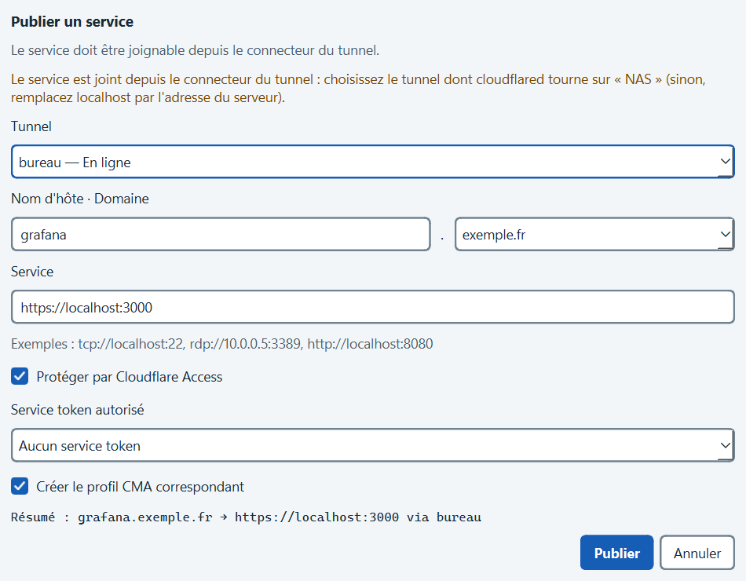

Le service est joint depuis le connecteur du tunnel : choisissez le tunnel dont cloudflared tourne sur ce serveur.
Si le connecteur est sur une autre machine, remplacez `localhost` par l'adresse du serveur.

## Un service ne répond plus (erreur 502, 1033…)

CMA teste toutes les 15 minutes, depuis Internet, chaque nom d'hôte HTTP des tunnels en service (Paramètres ›
Général › Cloudflare). Un nom en panne apparaît en notification, dans « Cloudflare · 1 ! » de la navigation,
sur sa carte et dans la carte **Santé du compte** de la page Sessions (avec les tunnels en panne et les service
tokens à renouveler ; **Voir** mène à l'objet).

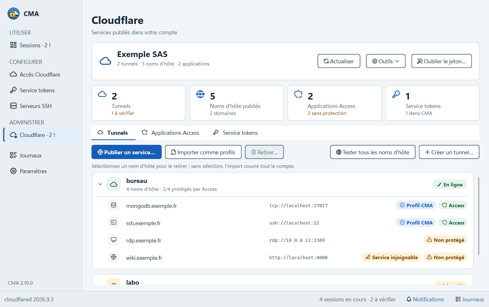

Pour tester à la demande : clic droit sur un nom d'hôte › **Tester depuis Internet**, ou **Tester tous les noms
d'hôte** pour un tableau récapitulatif, pannes en premier. Le conseil de la ligne choisie s'affiche dessous.

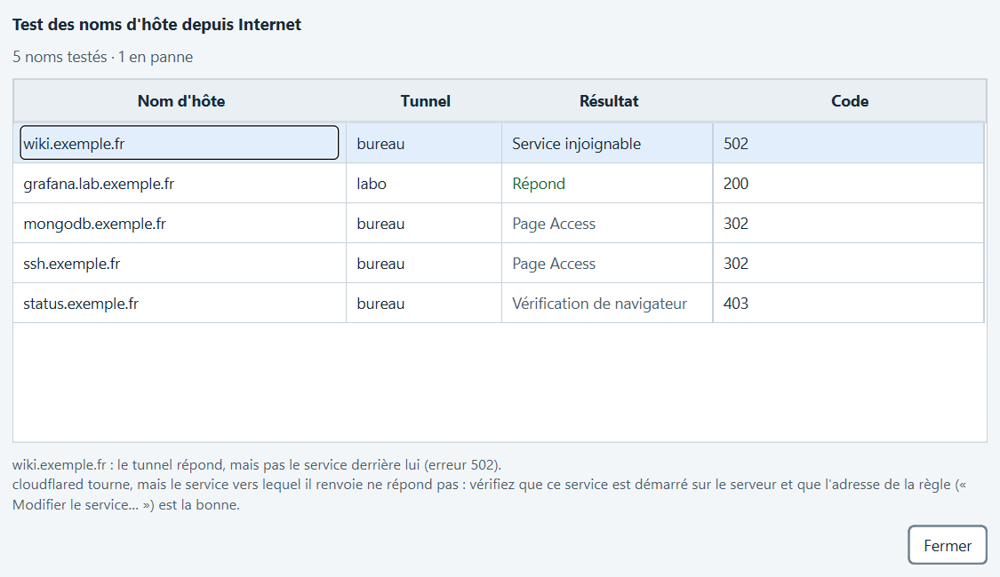

| Résultat | Ce que cela veut dire | Que faire |
| --- | --- | --- |
| **Service injoignable** (502, 504) | Le tunnel répond, pas le service derrière lui. | Vérifier que le service tourne sur le serveur, puis l'adresse de la règle (**Modifier le service…**). |
| **Aucun connecteur** (1033) | Aucun cloudflared n'est relié au tunnel. | Relancer cloudflared sur le serveur ; **État des connecteurs…** dans le menu du tunnel. |
| **Nom introuvable** | Le nom n'existe pas dans le DNS public. | **Corriger le DNS…** dans le menu du nom d'hôte. |
| **Vérification de navigateur** | Un réglage de sécurité de la zone (Bot Fight Mode, « I'm Under Attack », règle WAF) demande un défi. | Rien pour un humain ; pour une machine munie d'un service token, régler l'exception dans le tableau de bord (Sécurité). |
| **Page Access** | Access demande de se connecter : normal sans service token. | Rien. Un service SSH, RDP ou TCP n'est testé que jusque-là ; testez-le avec une session. |
| **Token refusé** (401, 403) | Le service token du profil n'est autorisé par aucune politique. | **Autoriser un service token…** dans l'onglet Applications. |

Avec la permission « Analytics : Read » sur le jeton, chaque carte montre aussi le trafic des dernières 24 heures
et le nombre d'erreurs 5xx renvoyées aux visiteurs.

Sans ouvrir la fenêtre : tant qu'un tunnel ou un service est en panne, le menu de l'icône de la zone de notification
(clic droit) contient un sous-menu **Pannes (N)**. Chaque tunnel et chaque service en panne y a son propre menu :
**Ouvrir** affiche la vue Cloudflare, **Mettre en sourdine 1 h** coupe les alertes de cet objet pour une heure.
**Relever maintenant**, en bas, refait le relevé des tunnels et des services sans attendre le prochain passage.

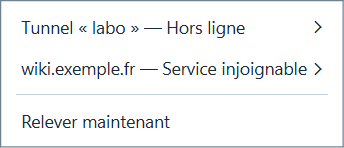

## Être prévenu sur son téléphone, suivre la disponibilité

**Paramètres › Général › Alertes › Ajouter un canal…** : choisissez le type et collez l'adresse.

| Type | Adresse |
| --- | --- |
| ntfy (application ntfy sur le téléphone) | `https://ntfy.sh/<un sujet difficile à deviner>`, ou votre propre serveur ntfy |
| Slack | webhook entrant de l'application Slack |
| Microsoft Teams | workflow « Publier dans un canal quand une requête webhook est reçue » |
| Discord | webhook du salon (Paramètres du salon › Intégrations) |
| Webhook | toute adresse qui accepte un JSON (`title`, `text`, `level`, `at`) |

**Envoyer un test** vérifie le canal. Les pannes et les retours partent ensuite vers chaque canal actif, depuis CMA
ouvert comme depuis la tâche planifiée (Paramètres › Général › Cloudflare).

**Envois récents…** (même section) ouvre le journal des 200 derniers envois vers vos canaux : date, canal,
nature (panne, retour, rappel, résumé, test), objet et résultat. Un échec s'affiche en rouge avec son motif.
L'adresse d'un canal n'y figure jamais. **Effacer le journal…** le vide, après confirmation, sans rien changer
aux rappels ni au résumé. `cma alerts test` et `cma alerts digest` y notent aussi leurs envois.

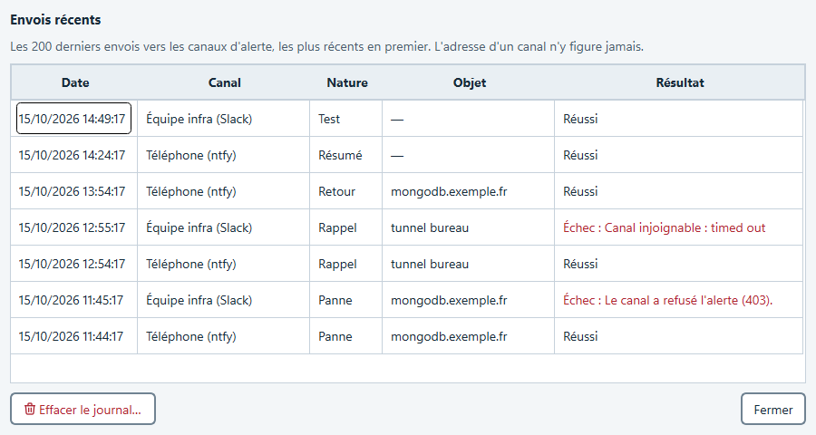

Une maintenance prévue ? Clic droit sur le tunnel ou le nom d'hôte › **Mettre en sourdine** : il reste relevé, mais
ne déclenche ni notification ni alerte jusqu'à la fin de la sourdine.

Une maintenance qui revient chaque semaine se déclare une fois pour toutes, dans **Paramètres › Général › Alertes ›
Maintenance et rappels** : **Ajouter…** demande le jour, l'heure de début et l'heure de fin (heure locale ; si la
fin est avant le début, la maintenance passe minuit et se termine le lendemain ; une fin égale au début couvre la
journée entière), puis l'objet visé (un tunnel, un nom d'hôte ou tout le compte) et un libellé facultatif. Pendant le créneau, l'objet est relevé comme d'habitude mais ne
déclenche ni notification, ni alerte, ni rappel.

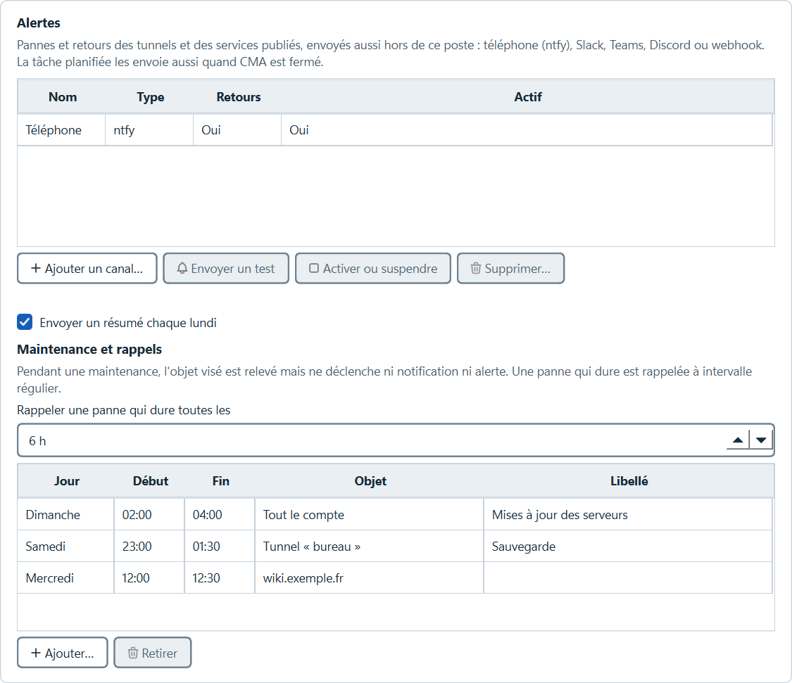

Pendant une maintenance prévue, le tunnel ou le nom d'hôte concerné porte la pastille **Maintenance** dans la
vue Cloudflare. Survolez la carte pour voir l'heure de fin et le libellé. Un nom d'hôte suit son tunnel, et
une maintenance de tout le compte couvre tout. Un objet en maintenance n'apparaît pas dans le sous-menu
**Pannes** de l'icône.

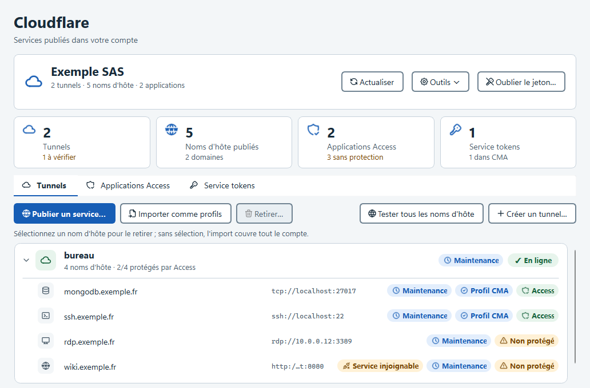

Dans la même section, **Rappeler une panne qui dure toutes les** renvoie un message sur les canaux d'alerte tant
qu'une panne n'est pas finie (« Jamais » par défaut, jusqu'à 168 h). Un objet en sourdine ou en maintenance n'est
pas rappelé. La case **Envoyer un résumé chaque lundi** envoie à chaque canal, le lundi à partir de 9 h (heure
locale) et une fois par semaine, la disponibilité des 7 derniers jours, les incidents et les service tokens à
renouveler ; `cma alerts digest` l'envoie à la demande. Quand CMA est fermé, la tâche planifiée envoie à sa place les
rappels et le résumé.

Quand vous coupez la surveillance des tunnels ou celle des services (Paramètres › Général › Cloudflare), les
incidents en cours de ce type sont clos à la vérification suivante, sans notification : une coupure brève clôt
donc un incident, qui sera rouvert comme un nouvel incident au relevé suivant si l'objet est toujours en panne.
Avec la surveillance des tunnels coupée, la tâche planifiée ne journalise plus les tunnels et n'en alerte plus.

### Retrouver ses alertes sur un autre poste

**Paramètres › Données › Exporter…** (ou **Exporter…** d'une liste de profils) range aussi vos canaux d'alerte
(nom, type, actif, retours) et vos maintenances : la case **Inclure les canaux d'alerte et les maintenances**
est cochée d'office. À l'import, **Reprendre les réglages des rappels et du résumé** (décochée d'office)
reprend aussi le rappel des pannes et le résumé du lundi. Rien n'est dupliqué : un canal du même nom et du même
type, ou une maintenance identique, déjà présents sont ignorés.

L'adresse d'un canal vaut un jeton : elle n'est **jamais** écrite dans un export non chiffré. Le canal est alors
importé **désactivé** : ressaisissez son adresse dans Paramètres › Général › Alertes, puis activez-le. Dans un
export chiffré (case **Inclure les secrets**, avec une phrase de passe), l'adresse suit, chiffrée comme les
autres secrets, et le canal reste actif.

### Suivre la disponibilité, fixer des objectifs

Sur la page **Sessions**, la tuile **Disponibilité** donne d'un coup d'œil le taux des 7 derniers jours, le nombre
d'incidents et l'objet le moins disponible ; **Détail** ouvre la boîte ci-dessous sur cet objet. Elle reste cachée
tant que la surveillance n'a rien relevé. Quand la carte « Santé du compte » signale une panne, son bouton
**Disponibilité** ouvre la même boîte sur le premier objet en panne.

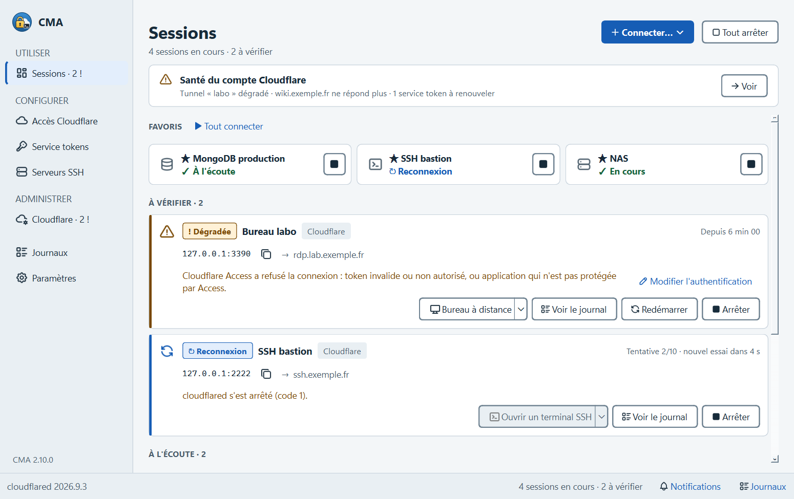

**Outils › Disponibilité…** montre, pour chaque tunnel et service, le taux de disponibilité sur 7 et 30 jours, le
temps de réponse moyen, le nombre d'incidents, l'objectif et la liste des incidents (début, fin, durée, cause).
Choisissez une ligne pour son graphique jour par jour (7, 30 ou 90 jours) : une barre par jour local (verte à partir
de 99,9 %, orange à partir de 98 %, rouge en dessous) et la courbe du temps de réponse moyen.

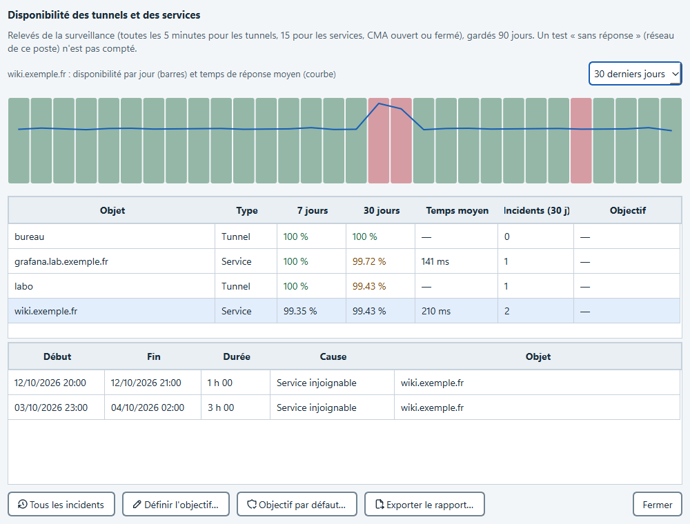

**Exporter le rapport…** enregistre la période choisie en page HTML autonome (à joindre à un compte rendu) ou en CSV
pour un tableur : disponibilité, durée des pannes et incidents de chaque objet.
En ligne de commande, `cma availability --output rapport.html` (ou `.csv`, `.json`) écrit le même rapport.

Un service doit tenir au moins 99,9 % du temps ? **Définir l'objectif…** (même boîte) fixe la disponibilité minimale
attendue du tunnel ou du service choisi, de 50 à 100 %. **Objectif par défaut…** fixe celle de tous les objets qui
n'ont pas d'objectif propre, et **Retirer l'objectif**, dans la boîte de saisie, supprime l'objectif d'un objet. La
colonne **Objectif** le compare à la disponibilité des 30 derniers jours : sous l'objectif, la valeur porte un ▼ et,
avec le taux sur 30 jours, la teinte d'alerte. Sans objectif, elle affiche « — ».

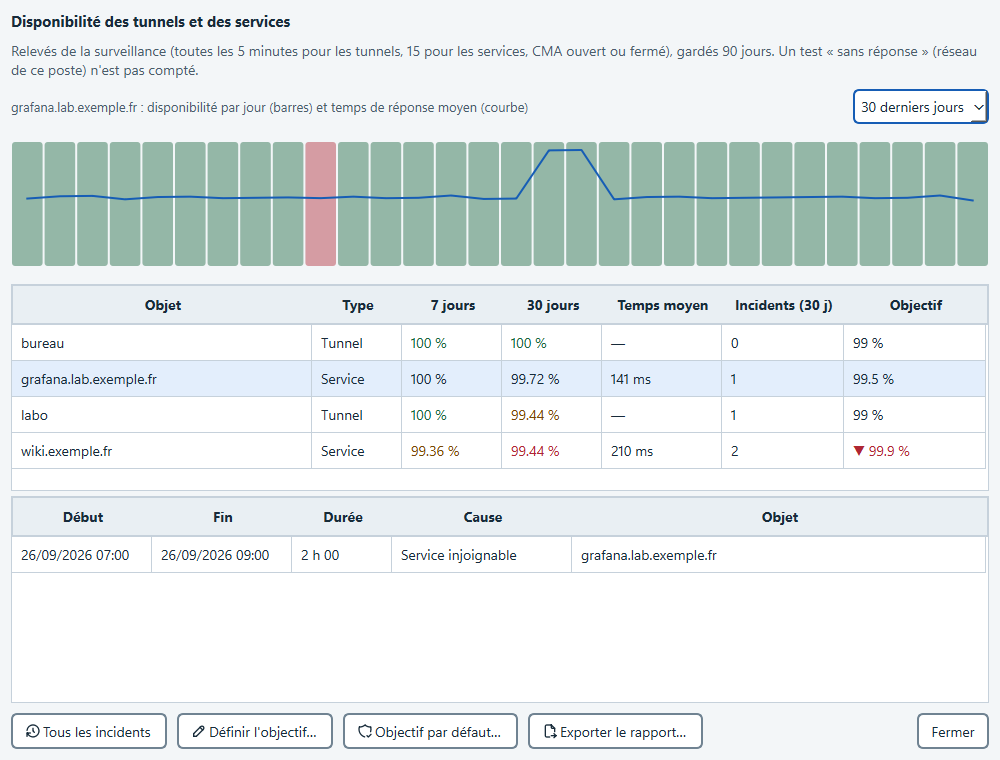

Quand un tunnel ou un service passe sous son objectif, CMA envoie **une seule alerte** à chaque canal d'alerte actif
(« objectif manqué »), puis un message de retour quand il remonte au-dessus (« objectif retrouvé », seulement aux
canaux qui reçoivent les retours), depuis CMA ouvert comme depuis la tâche planifiée. Rien n'est envoyé pour un objet
en sourdine ou en maintenance (le message vient à la fin de la sourdine si la situation dure), ni pour un objet sans
relevé sur les 30 jours, ni pour un type que la surveillance ne relève plus. **Envois récents…** note ces messages avec
la nature **Objectif**.

Limite : une disponibilité qui oscille autour de l'objectif peut alterner alerte et retour (pas d'hystérésis).

Pour un compte rendu mensuel, `cma availability --month 2026-10` donne la disponibilité du mois civil (en jours
locaux) de chaque tunnel et service, avec son objectif et l'écart en points ; le mois en cours va jusqu'à aujourd'hui.
Avec `--output rapport.html` (ou `.csv`, `.json`), le rapport part dans un fichier : une ligne par objet, puis les
incidents du mois.

## Renouveler un service token

CMA prévient 30 jours avant l'échéance d'un service token, puis à l'échéance.

1. Depuis la notification (**Renouveler**) ou **Cloudflare › Service tokens**, sélectionnez le token.
2. **Prolonger** repousse l'échéance, sans changer le secret ni couper les accès : rien d'autre à faire.
3. **Changer le secret…** si le secret a pu fuiter : le nouveau secret part directement dans le coffre de CMA et
   les profils qui l'utilisent n'ont pas à changer. L'ancien est révoqué aussitôt : relancez les accès ouverts, et
   transmettez le nouveau secret aux autres postes qui l'utilisent.

## Donner accès à un réseau privé (WARP)

Les appareils munis du client WARP de votre organisation peuvent joindre des adresses privées (un serveur, un NAS)
à travers un tunnel, sans nom d'hôte publié.

1. **Cloudflare › Tunnels**, clic droit sur le tunnel › **Réseaux privés…**
2. Saisissez la plage (`10.0.0.0/24`, ou une seule adresse `10.0.0.20`), le réseau virtuel et un commentaire,
   puis **Ajouter la route**. Le routage WARP du tunnel est activé avec la première route.

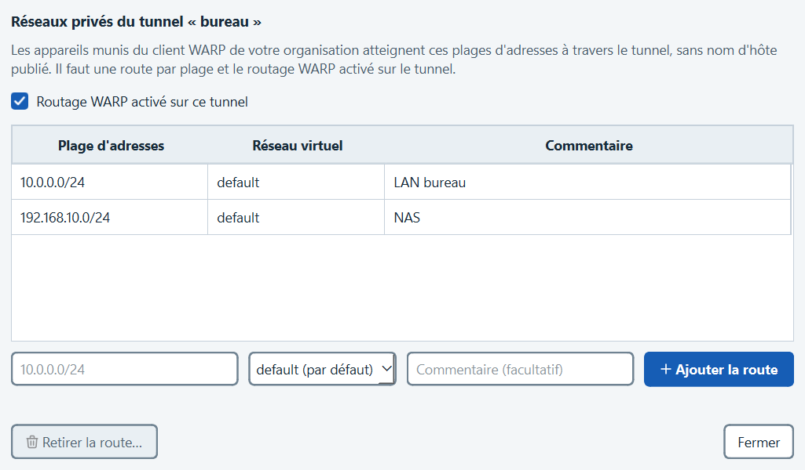

Les politiques d'accès des appareils WARP se règlent dans Cloudflare Zero Trust, pas dans CMA.

## Vérifier la sécurité du compte

**Outils › Bilan de sécurité…** liste ce qui expose un service (nom d'hôte publié sans Access, politique ouverte à
tout le monde), ce qui traîne (token inutilisé depuis 90 jours, politique sans application, DNS vers un tunnel
supprimé) et ce qui est cassé (token expiré, application sans politique).

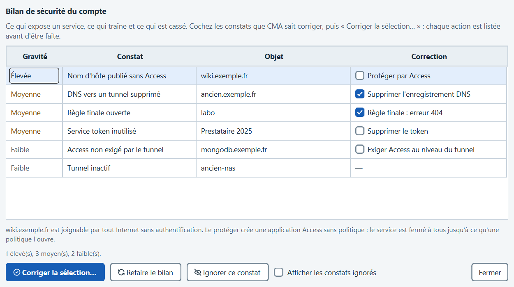

1. Choisissez un constat : son explication s'affiche dessous.
2. Cochez ceux que CMA sait corriger, puis **Corriger la sélection…** : chaque action est listée avant d'être faite.
   « Protéger par Access » ferme le service à tous jusqu'à ce qu'une politique l'ouvre : il n'est jamais coché
   d'office.
3. Un site public voulu ? **Ignorer ce constat** : il ne sera plus compté (« Afficher les constats ignorés » pour
   revenir dessus).

Pour aller plus loin sur un nom d'hôte protégé : clic droit › **Exiger Access au niveau du tunnel**. Le tunnel vérifie
alors lui-même le jeton Access ; si l'application Access disparaît, le service reste fermé. Il faut la permission
« Access: Organizations, Identity Providers, and Groups : Read » sur le jeton.

Enfin, **Paramètres › Général › Cloudflare › Jeton de la surveillance** : un jeton en lecture seule pour la
surveillance limite les dégâts si ce poste est compromis.

## Savoir ce qui a changé sur le compte

Menu **Outils** de l'en-tête du compte :

- **Journal d'audit du compte…** : qui a modifié quoi depuis 30 jours, depuis le tableau de bord, un jeton d'API
  (dont CMA) ou Cloudflare lui-même. Filtrable, exportable en CSV.
- **Instantanés de la configuration…** : prenez un instantané avant une intervention, puis **Comparer à l'état
  actuel** montre chaque champ modifié depuis, y compris ce qui a été fait ailleurs. Un instantané ne contient
  aucun secret ; les 30 derniers sont gardés.

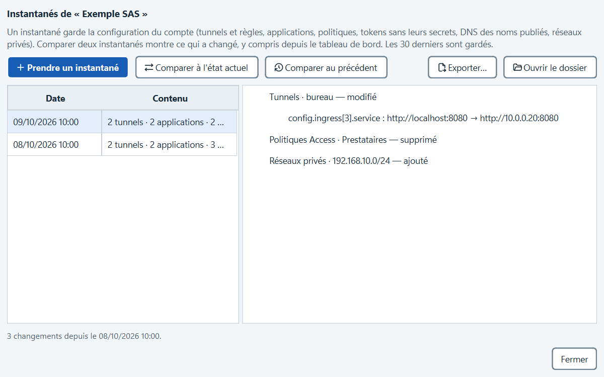

En ligne de commande, `cma snapshot` enregistre un instantané et affiche ce qui a changé depuis le précédent (code
de retour 2 s'il y a des changements) : de quoi le planifier chaque nuit.

- **Permissions du jeton…** : chaque fonction de CMA, la permission qu'elle demande, et si elle fonctionne.

## Partager un accès avec un collègue

Dans **Accès Cloudflare**, menu d'un profil › **Partager…** :

- **Lien de connexion** (`cma://connect/…`) : ouvre la connexion sur votre poste, depuis un favori ou une
  documentation. CMA demande confirmation la première fois.
- **Lien de partage** ou **Enregistrer en fichier .cma…** : recrée le profil chez un collègue qui a CMA, **sans
  aucun secret**. Si le profil utilise un service token, transmettez son secret à part, par un canal sûr.

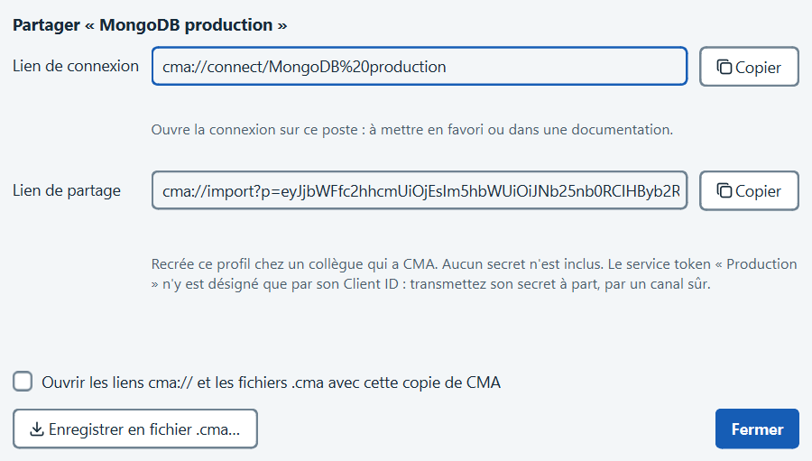

L'installeur associe les liens `cma://` et les fichiers `.cma` à CMA. Pour les versions portable et Scoop, cochez
la case dans **Partager…**.

## Travailler avec plusieurs comptes Cloudflare

Un même jeton d'API peut donner accès à plusieurs comptes : le choix du compte est alors dans l'en-tête de la vue
Cloudflare. Pour un autre accès Cloudflare (un client, un compte personnel), **Outils › Ajouter un jeton d'API…** :
collez le jeton et donnez-lui un nom. Le choix du jeton apparaît alors dans l'en-tête ; chaque jeton revient à son
dernier compte, et la surveillance suit le jeton choisi.

### Être prévenu des pannes de tous les comptes

Par défaut, la surveillance ne relève que le compte affiché dans la vue Cloudflare : les pannes des autres comptes ne
vous préviennent pas. Cochez **Paramètres › Général › Cloudflare › Surveiller tous les comptes** (la case est
disponible à partir de deux jetons) pour relever **chaque jeton d'API enregistré**, avec le dernier compte choisi avec
lui, CMA ouvert comme depuis la tâche planifiée. Le jeton affiché garde le compte de la vue ; un jeton qui n'a encore
choisi aucun compte prend le premier qu'il voit. Un compte vu par deux jetons n'est relevé qu'une fois (le jeton de la
surveillance, s'il est choisi, passe d'abord).

- Dès que deux comptes sont surveillés, le nom du compte suit chaque tunnel et chaque nom d'hôte en panne : « labo
  (Compte A) ». Il apparaît dans les notifications, les alertes envoyées aux canaux, le sous-menu **Pannes** de l'icône
  et le journal de disponibilité. Deux comptes du même nom sont distingués par le nom de leur jeton.
- Un jeton refusé, absent du coffre ou injoignable n'arrête pas les autres : il est signalé dans le journal de CMA et,
  pour `cma tunnels`, sur la sortie d'erreur (code de retour 1 si rien d'autre ne va mal ; avec `--json`, chaque
  tunnel porte son compte dans `account`). Tant qu'un compte n'a pas pu être lu, CMA ne clôt aucun de ses incidents et
  n'annonce pas de faux retour.
- Pour surveiller **deux comptes d'un même jeton**, enregistrez le jeton deux fois, sous deux noms, et choisissez un
  compte différent avec chacun.
- Les objectifs, sourdines et maintenances restent par tunnel et par nom d'hôte : rien à refaire en activant ou en
  coupant le réglage.

Limites : **Ouvrir** (sous-menu **Pannes**) sur un objet d'un autre compte mène au compte affiché, pas au sien :
choisissez d'abord son jeton dans la vue Cloudflare ; la notification d'une panne d'un autre compte ne propose pas
**Diagnostiquer…** ; la carte « Santé du compte » ne nomme le
compte que pour une panne unique (avec plusieurs pannes, elle les résume).

Attention : **tous les jetons du coffre servent alors à la surveillance**, tâche planifiée comprise. Pour un compte
que vous ne faites que surveiller, enregistrez un jeton en lecture seule. Le nom du compte part vers les canaux
d'alerte : chez Cloudflare, le nom par défaut d'un compte contient l'adresse e-mail de son propriétaire (« …'s
Account »). Renommez le compte si un canal est public (un sujet ntfy). Voir [SECURITE.md](SECURITE.md) et l'[ADR
0003](adr/0003-surveillance-de-plusieurs-comptes.md).

## Automatiser en ligne de commande

La commande `cma` (installée avec l'application) lit les mêmes données que l'interface, avec le jeton d'API actif
(celui de la surveillance pour `cma tunnels`, s'il est choisi).
Chaque commande rend un code de retour exploitable par une tâche planifiée ou une supervision : 0 si tout va bien,
2 si quelque chose demande votre attention, 1 en cas d'erreur. Une option mal écrite est refusée avec un
message d'usage et le code 2 : essayez la commande à la main avant de la planifier.

| Commande | Ce qu'elle fait | Code 2 si… |
| --- | --- | --- |
| `cma tunnels [--services] [--json]` | état des tunnels, et avec `--services` le test de chaque nom d'hôte HTTP ; avec « Surveiller tous les comptes », chaque jeton avec son compte | un tunnel ou un service est en panne (code 1 si un jeton est illisible et que rien d'autre ne va mal) |
| `cma availability [--days 1/7/30/90] [--json] [--output FICHIER]` | disponibilité et incidents relevés par la surveillance ; `--output` écrit le rapport dans un fichier `.html`, `.csv` ou `.json` (selon l'extension) au lieu de l'afficher | un incident est en cours (code 1 si le fichier ne peut pas être écrit ou si l'extension est inconnue) |
| `cma availability --month AAAA-MM [--json] [--output FICHIER]` | rapport d'un mois civil (jours locaux) avec l'objectif et l'écart de chaque objet ; le mois en cours va jusqu'à aujourd'hui ; exclusif avec `--days` ; sans relevé ce mois-là : « Aucun relevé en AAAA-MM. » | — (code 1 si le mois est invalide ou à venir, ou si le fichier ne peut pas être écrit) |
| `cma review [--json] [--all]` | bilan de sécurité du compte (`--all` : avec les constats ignorés) | un constat de gravité élevée n'est pas ignoré |
| `cma snapshot` | instantané de la configuration, et ce qui a changé depuis le précédent | quelque chose a changé |
| `cma alerts test` | un message de test vers chaque canal d'alerte actif | — (code 1 si un canal échoue) |
| `cma alerts digest` | le résumé de la semaine, tout de suite, vers chaque canal d'alerte actif | — (code 1 sans canal actif ou si un canal échoue) |

Exemples : `cma review` planifié chaque lundi, qui échoue si un constat élevé apparaît ;
`cma availability --days 30 --json` en fin de mois pour alimenter un tableau de bord ; `cma availability --days 30
--output rapport.html` pour en tirer une page à joindre à un compte rendu ; `cma availability --month 2026-10 --output
octobre.html` pour le rapport du mois, objectifs compris.

## Raccourcis clavier et nouveautés

**F1** ouvre la liste des raccourcis clavier (aussi dans **Paramètres › À propos**). Le plus utile : **Ctrl+K**, la
palette de commandes, qui trouve par son nom tout accès, serveur, objet du compte ou action de CMA.

Après une mise à jour, **Quoi de neuf** présente une fois les nouveautés des versions installées depuis la dernière
ouverture. On le retrouve dans **Paramètres › À propos** et dans la palette.
